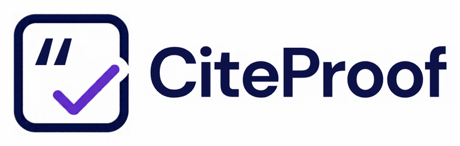

<p align="center">
  
</p>

# CiteProof

Audit a reference list, and the claims those references are meant to support, without trusting an AI's word that they are real.

CiteProof checks references against a catalogue of records **you supply** and routes every claim-to-source link to a person. It runs offline, uses only the Python standard library, and makes no network requests.

Two checks live here because they answer one question from two sides: does the reference exist and match (`check`), and does the source actually say what the text claims (`claims`).

## Install

Requires Python 3.10 or newer.

```bash
pip install git+https://github.com/seun-john/citeproof.git
```

## Check references

```bash
citeproof from-bibtex refs.bib --input-out input.json     # optional: start from a .bib file
citeproof check input.json -o report.json --html report.html
```

```json
{
  "references": [{"id": "r1", "doi": "https://doi.org/10.1/x", "title": "A Study of Things",
                  "authors": ["Ada Lovelace", "Alan Turing"], "year": 2020, "journal": "J Things"}],
  "catalogue":  [{"doi": "10.1/x", "title": "A Study of Things", "authors": ["Alan Turing", "Ada Lovelace"],
                  "year": 2020, "journal": "J Things", "retracted": false, "provenance": "Crossref export, 2026-10-01"}],
  "citations": ["r1"]
}
```

| Status | Meaning |
| --- | --- |
| `VERIFIED` | DOI found in the catalogue and every compared field matches. |
| `METADATA_MISMATCH` | DOI found, but a field differs. Titles carry a similarity score and a note ("near match, probably a typo" or "different title"); authors say whether the same people appear in another order. |
| `NEEDS_REVIEW` | No DOI, DOI not in the catalogue, or retraction status not supplied. **This is not evidence of fabrication.** |
| `DUPLICATE` | Same DOI or normalised title as an earlier reference. |
| `RETRACTED` | The catalogue flags the work as retracted. Check where the flag came from. |
| `UNCITED_REFERENCE`, `MISSING_REFERENCE` | In the bibliography but not cited, or cited but not in the bibliography. |

DOIs are compared after removing `https://doi.org/`, `http://dx.doi.org/`, `doi:` and trailing punctuation, and lowercasing. Author lists can be arrays or `"A; B and C"` strings. Years compare by their four digits, so `2020a` equals `2020`.

Two equivalences are accepted rather than reported as mismatches, and are listed in the finding's `accepted_equivalences` so they stay visible:

- **Abbreviated journal names.** `Nat Prod Rep` matches `Natural Product Reports`, `N Engl J Med` matches `New England Journal of Medicine`, in either direction. Each word must be the same word or its beginning (plus a few standard forms such as `Natl`), the word count must agree once `of`, `the` and `and` are ignored, and a single closing letter must match exactly, so `Nature` is not `Nature Medicine` and `Phys Rev A` is not `Physical Review Applied`. A subtitle after a colon in the catalogue name may be left out. Abbreviations that omit a word, or that are not on this pattern, are still reported as a journal mismatch.
- **A `RETRACTED:`, `Retraction:` or `Withdrawn:` prefix on a title.** Publishers add it to the catalogue title; the citation does not carry it. The prefix is ignored for the comparison only. The retraction itself is still reported through `RETRACTED` when the catalogue flags it.

## Check claims

```bash
citeproof claims claims.json -o claims-report.json
```

```json
{"claims": [{"text": "Rates fell by 12.5%.",
             "source": {"id": "s1", "page": 4, "kind": "full_text",
                        "passage": "Overall, rates fell by 12.50% in the cohort."}}]}
```

Findings: `NO_CITATION`, `SOURCE_UNAVAILABLE`, and `HUMAN_REVIEW_REQUIRED` for everything that has usable evidence. The review finding records whether the claim's exact wording is in the passage and which numbers in the claim are absent from it. Numbers are compared by value (`12.50%` equals `12.5%`, `1,000` equals `1000`). A title, abstract or snippet is never accepted as support. **CiteProof never marks a claim as supported.**

## Options common to every command

`-o report.json`, `--html report.html`, and `--strict` (exit 1 when any finding is not `VERIFIED` for `check`, or any finding at all for `claims`). Exit codes: 0 audit completed, 1 strict findings, 2 unusable input, 3 `--min-coverage` was not met. A completed audit that reports problems exits 0 unless you pass `--strict`.

**Coverage.** `check` and `claims` add a `coverage` object and print a line on stderr, for example `coverage: decided 37 of 60 references; 23 could not be checked (not_in_catalogue 15, no_doi 8)`. For `check` the items are the references: one is decided when it matched a catalogue record (`VERIFIED` or `METADATA_MISMATCH`) and undecided when it has no DOI or its DOI is not in the catalogue you supplied. Undecided does not mean fabricated; this tool never looks anything up online. For `claims` the items are the claims, and only a missing citation is decided; the rest are undecided (`no_source_passage`, `abstract_or_snippet_only`, `needs_human_judgement`) because support is never decided here. `--min-coverage PCT` exits 3 when fewer than PCT percent of items were decided and nothing else failed.

## Limits

- No online lookup. If you want Crossref or OpenAlex data, export it yourself and pass it as the catalogue. A catalogue is only as trustworthy as its source, so record `provenance`.
- No manuscript parsing. Reference lists come from your JSON or a `.bib` file. The BibTeX reader covers ordinary entries; it does not expand `@string` macros or `crossref` fields.
- Title and author comparison is lexical. A reference can match a real record and still be cited for the wrong reason, which is what `claims` is for.
- Reports can contain source passages and confidential text. Read them before sharing.

## Develop

```bash
pip install -e ".[dev]"
ruff check . && ruff format --check . && pytest -q
```

MIT licence.


## Research paper

This tool was evaluated, with and without each tool, in an open preprint: Oluwawalemi, O. J. (2026). Do Verification Tools Improve on an AI Reader? A With-and-Without Evaluation of Fifteen Open-Source Tools for AI-Assisted Research. Zenodo. https://doi.org/10.5281/zenodo.23404947

The test corpora, truth labels, verdicts and scripts are in the same Zenodo record. Independent replication and testing are welcome. Please open an issue to share results.
